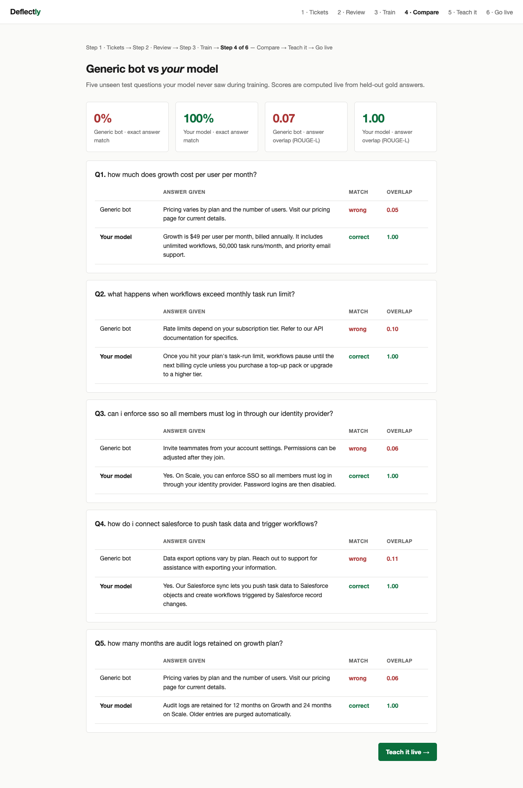

# Deflectly

**Support AI that trains on your own support tickets in ~0.07 seconds — no LLM, no API key, no GPU, no
per-answer cost.**

[](https://github.com/Yayihie/deflectly/actions/workflows/ci.yml)
[](LICENSE)
[](https://www.python.org/)

**[Live demo](https://deflectly-production.up.railway.app)** — paste tickets, train, compare, correct it, embed the widget.



## The part that is actually interesting

Most support-AI products in 2026 are an LLM wrapper: an API key, a per-token bill, a prompt you can't
audit, and an answer that might invent a refund policy. This repo goes the other way.

Answers come from **retrieval over your own past replies**, built from three fused TF-IDF channels:
word-level over questions, word-level over answers, and a character 3-5-gram matcher for typos and
phrasing. It trains in ~0.07s on a CPU, scores 5/5 on held-out questions where a generic bot scores 0/5,
and costs nothing per answer. Because it only ever returns text your team already wrote, it cannot make
up a policy.

The consequence is the point: **learning is a 30-millisecond index rebuild, not a fine-tuning run.** When
an agent corrects an answer, the next customer gets the correction. That loop is the product, and the
`/teach` step lets you watch it happen.

## Try it

```sh
pip install -r requirements.txt
cd app && python3 app.py            # http://127.0.0.1:8451
```

Or with the exact production entrypoint (two workers, as deployed):

```sh
pip install -r requirements.txt
PORT=8451 gunicorn app.app:app --bind 0.0.0.0:$PORT --workers 2 --timeout 120
```

Six steps, about three minutes:

| Step | What happens |
|---|---|
| 1 · Tickets | Paste Q/A pairs from Intercom / Help Scout / Zendesk, upload a file, or load the built-in 56-ticket sample ("Nimbus HQ") |
| 2 · Review | Fix bad pairs; customer PII (emails, phones) is flagged so it can be stripped. Only approved pairs train |
| 3 · Train | Live SSE log of the index build. ~0.07s, on CPU |
| 4 · Compare | 5 unseen questions, generic baseline vs. your model, exact-match and ROUGE-L scored against held-out gold answers |
| 5 · Teach it | Mark an answer wrong, type the right one, watch confidence move on the next ask |
| 6 · Go live | Embed snippet for the widget, whose 👍/👎 corrections feed the same loop |

## Reproduce the numbers

```sh
python3 scripts/benchmark.py
```

```
model                 exact match     ROUGE-L     train time
--------------------------------------------------------------
generic baseline      0/5 (0%)        0.075       0.009s
store-trained         5/5 (100%)      1.000       0.030s

correction loop, same question: 0.751 -> 0.842 confidence (retrain 0.030s)
```

Nothing in this README is a claim you can't re-run. `scripts/smoke.py` exercises the same path end to end
over HTTP against any instance, including the live deployment:

```sh
python3 scripts/smoke.py https://deflectly-production.up.railway.app
```

## API

| Endpoint | Purpose |
|---|---|
| `POST /api/tickets` · `/api/upload` · `/api/sample` · `/api/import` | Load tickets (paste, file, sample corpus, helpdesk sync skeleton) |
| `POST /api/review` | Approve/clean the training set |
| `POST /api/train` | Train; streams SSE progress |
| `POST /api/compare` | Baseline vs. your model on held-out questions |
| `POST /api/predict` | Answer a question from the trained model (the widget endpoint) |
| `POST /api/feedback` | 👍/👎; a 👎 with `corrected_answer` retrains immediately |
| `GET /api/healthz` · `GET /api/stats` | `{"ok": true}` (deploy healthcheck) and session/correction counters |

## Embedding it

```html
<script defer src="https://your-deflectly.example/static/widget.js"
  data-endpoint="https://your-deflectly.example/api/predict"
  data-title="Support"
  data-primary="#0a6e3c"></script>
```

## Layout

```
app/app.py                 Flask app, SQLite, all routes
app/model.py               three-channel TF-IDF responder (+ save/load)
app/data/sample_data.py    56-ticket sample corpus, 5 held-out questions, baseline KB
app/static/widget.js       embeddable widget with the feedback loop
app/templates/             landing, demo steps, review, teach, widget
scripts/smoke.py           HTTP end-to-end check (used by CI and after deploys)
scripts/benchmark.py       reproduces the table above, offline
tests/                     13 tests
```

## Deploy

```sh
docker build -t deflectly:latest . && docker run -p 8451:8451 deflectly:latest
```

Railway / Render / fly.io / Heroku work as-is (`Dockerfile`, `Procfile`, and `railway.json` with a
healthcheck on `/api/healthz`, so a broken revision never goes live). Notes in `DEPLOY.md`.

| Env var | Purpose |
|---|---|
| `PORT` | HTTP port (Railway/Render inject it; default 8451) |
| `SECRET_KEY` | Flask session secret. Set it in production. If unset, a random key is generated once and persisted to `app/.session_key` so all workers agree |
| `STRIPE_SECRET_KEY` | Optional; Stripe test-mode checkout instead of demo intent recording |

## Running with more than one worker

This is built to run under `gunicorn --workers 2`, which is where the interesting bugs live. Session state
(tickets, review status, model version) lives in SQLite, and trained models are written to
`app/models/<session>.pkl` with a version stamp, so every worker serves the current model instead of its
own stale copy. Four tests exist purely to pin that down:

- `test_state_survives_worker_switch`, `test_review_then_train_survives_stale_cache` — state is not per-process
- `test_compare_page_reloads_model_on_other_worker` — any worker can rebuild a trained model
- `test_correction_visible_across_workers` — a correction made on one worker is not served stale by another
- `test_secret_key_race` — workers booting at the same moment must agree on one session secret

## Limits

- Retrieval, not a fine-tuned model: fast, free, grounded, and it can't hallucinate a policy — but it plateaus on paraphrase-heavy corpora. Embeddings or a cross-encoder reranker are the natural next step, and the eval harness exists to show whether a change actually wins.
- SQLite and `app/models/*.pkl` are container-local; on Railway/Render that disk is ephemeral. Attach a volume or move to Postgres before carrying real customer data. Model files are pruned to the newest 200.
- `POST /api/import` is a skeleton, not a real helpdesk sync.
- Checkout is demo-grade: it records intent, or creates a Stripe test-mode session when a key is set.
- No auth or per-tenant isolation — a single-session demo, not a multi-tenant service.

## Contributing

See `CONTRIBUTING.md`. The short version: a regression test must fail without your fix.

## License

MIT — see `LICENSE`.
